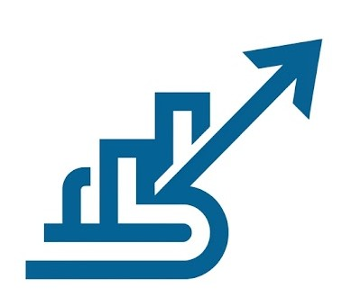

# SIMANTAP — Sistem Manajemen Tim & Pantau Performa


<p align="center">
  
</p>

**SIMANTAP** (*Sistem Manajemen Tim dan Pantau Performa* / *Team Management & Performance Platform*) adalah aplikasi web manajemen proyek, pelacakan tugas (*work items*), dan pemantauan performa tim yang **terinspirasi dari [Plane](https://plane.so)**.

Proyek ini dirancang dengan antarmuka *light-mode* yang bersih dan modern, dilengkapi dukungan multi-workspace, pelacakan item kerja dalam berbagai tampilan (*multi-view*), *command palette*, panel detail tugas interaktif, serta analitik performa personal.

---

## ✨ Fitur Utama

### 1. Autentikasi Simulasi (`/login` & `/login/choose-account`)
- Login menggunakan alamat email atau melalui simulasi **Sign in with Google** dengan daftar akun pilihan (`/login/choose-account`).
- Sesi pengguna disimpan di `localStorage` dan dilindungi oleh pengecekan autentikasi pada `DashboardShell`.

### 2. Beranda & Widget yang Dapat Dikustomisasi (`/`)
- **Greeting Header**: Sapaan personal sesuai nama pengguna yang sedang masuk.
- **Manage Widgets**: Kontrol untuk menampilkan atau menyembunyikan widget *Greeting Header*, *Quicklinks*, dan *Recents*.
- **Quicklinks**: Tambah, buka, dan hapus tautan referensi penting secara cepat.
- **Recents**: Daftar item kerja terbaru dengan filter status (`All`, `To-do`, `Completed`), pembuatan item baru, serta toggle penyelesaian tugas langsung dari daftar.

### 3. Manajemen Proyek & Multi-View Work Items (`/projects`)
- **Daftar & Pembuatan Proyek**: Buat proyek baru lengkap dengan nama, ID, deskripsi, ikon/emoji, *cover image* (galeri gambar, gradien warna, atau unggah file), *project lead*, dan pengaturan visibilitas publik/privat.
- **5 Tampilan Interaktif** (preferensi tampilan tersimpan per proyek):
  - **List**: Pengelompokan akordeon berdasarkan status (*Backlog*, *Todo*, *In Progress*, *Done*, *Cancelled*).
  - **Board**: Papan Kanban per kolom status.
  - **Table (Spreadsheet)**: Tabel terstruktur dengan pengeditan *inline* untuk status, prioritas, *assignee*, dan label.
  - **Calendar**: Tampilan kalender bulanan berdasarkan rentang/tenggat waktu tugas.
  - **Timeline**: Tampilan linimasa dengan skala mingguan (*week*) atau bulanan (*month*).
- **Kontrol Tampilan**: Pengaturan *Group by* (`status`, `assignee`, atau `none`) dan *Sort by* (`id`, `title`, atau `date`).

### 4. Work Item Detail Drawer (`WorkItemDetailDrawer`)
- Panel geser (*slide-over drawer*) di sisi kanan untuk melihat dan mengedit detail item kerja tanpa berpindah halaman.
- Mendukung edit judul dan deskripsi secara *inline*, pembaruan properti (*State*, *Assignees*, *Priority*, *Start Date*, *Due Date*, *Parent Work Item*, dan *Labels*), penambahan jumlah tautan (*links*) dan lampiran (*attachments*), salin tautan item kerja, riwayat aktivitas, serta kolom komentar.

### 5. Profil & Analitik Performa (`/profile`)
- **Tab Navigasi**: `Summary`, `Assigned`, `Created`, `Subscribed`, dan `Activity`.
- **Ringkasan Metrik & Beban Kerja**: Total item kerja yang dibuat, ditugaskan, dan diikuti, serta rincian status (*Backlog*, *Not started*, *Working on*, *Completed*, *Canceled*).
- **Visualisasi Data**: Grafik batang distribusi prioritas (*High*, *Medium*, *Low*) dan diagram donat status penyelesaian.
- **Kartu Profil**: Informasi pengguna beserta persentase progres penyelesaian untuk setiap proyek.

### 6. Produktivitas & Navigasi Global (`DashboardShell`)
- **Multi-Workspace Switcher**: Beralih antar-workspace atau buat workspace baru dari bilah navigasi atas.
- **Sidebar Responsif**: Dapat diciutkan (*collapsible*) di desktop dan mendukung menu geser pada tampilan mobile.
- **Command Palette (`Ctrl+K` / `⌘K`)**: Pencarian cepat item kerja dan aksi instan (*Create New Work Item*, *Create New Project*).
- **Notifikasi Toast & Reset Data**: Umpan balik instan via toast serta opsi **More → Reset Platform Data** di sidebar untuk mengembalikan data awal.

---

## 🛠️ Tech Stack

- **Framework**: [Next.js](https://nextjs.org/) `16.2.6` (App Router)
- **UI Library**: [React](https://react.dev/) `19.2.4` + React Compiler (`babel-plugin-react-compiler`)
- **Bahasa**: [TypeScript](https://www.typescriptlang.org/) `^5`
- **Styling**: [Tailwind CSS](https://tailwindcss.com/) `^4` (`@tailwindcss/postcss`) + Font `Geist` & `Geist Mono` (`next/font/google`)
- **Package Manager**: [Bun](https://bun.sh/) (`bun.lock`) / Node.js
- **Penyimpanan Data**: `localStorage` sisi klien (tanpa backend/database eksternal)

---

## 📁 Struktur Proyek

```text
.
├── public/
│   ├── logo.jpg                        # Logo aplikasi SIMANTAP
│   └── ...                             # Aset SVG bawaan
├── src/
│   ├── app/
│   │   ├── login/
│   │   │   ├── choose-account/
│   │   │   │   └── page.tsx            # Halaman simulasi pemilih akun Google
│   │   │   └── page.tsx                # Halaman login email & opsi masuk
│   │   ├── profile/
│   │   │   └── page.tsx                # Halaman profil pengguna & analitik performa
│   │   ├── projects/
│   │   │   └── page.tsx                # Halaman daftar proyek & multi-view work items
│   │   ├── globals.css                 # Konfigurasi Tailwind CSS v4 & token tema
│   │   ├── layout.tsx                  # Root layout, metadata, dan font Geist
│   │   └── page.tsx                    # Halaman beranda (Quicklinks & Recents)
│   └── components/
│       ├── DashboardShell.tsx          # Layout shell global (topbar, sidebar, command palette)
│       └── WorkItemDetailDrawer.tsx    # Panel geser detail, properti, komentar & aktivitas item
├── eslint.config.mjs
├── next.config.ts
├── package.json
├── postcss.config.mjs
└── tsconfig.json
```

---

## 🚀 Cara Menjalankan

### Prasyarat
- **Bun** (direkomendasikan, karena proyek menyertakan `bun.lock`) atau **Node.js v20+**.

### Langkah Instalasi

1. **Clone repositori**
   ```bash
   git clone https://github.com/Cahyadi-Prasetyo/Platform-Kinerja.git
   cd Platform-Kinerja
   ```

2. **Install dependensi**
   ```bash
   bun install
   # atau menggunakan npm
   npm install
   ```

3. **Jalankan server pengembangan**
   ```bash
   bun run dev
   # atau menggunakan npm
   npm run dev
   ```

4. **Buka di browser**
   Akses `http://localhost:3000`. Jika belum ada sesi aktif, aplikasi akan mengarahkan ke halaman `/login`.

### Skrip Tersedia (`package.json`)

| Perintah | Deskripsi |
| :--- | :--- |
| `bun run dev` | Menjalankan server development Next.js (`next dev --webpack`) |
| `bun run build` | Membangun aplikasi untuk produksi (`next build`) |
| `bun run start` | Menjalankan hasil build produksi (`next start`) |
| `bun run lint` | Menjalankan pemeriksaan kode dengan ESLint (`eslint`) |

---

## 💾 Catatan Penyimpanan Data

Saat ini aplikasi berjalan sepenuhnya di sisi klien (*client-side prototype*) menggunakan `localStorage` browser untuk menyimpan sesi akun, workspace, daftar proyek, work items, quicklinks, dan preferensi tampilan/widget. Data demo bawaan (seperti proyek `MAGANG UMRAH 2026`) dimuat otomatis saat pertama kali dibuka, dan seluruh data dapat diatur ulang kapan saja melalui menu **More → Reset Platform Data** di sidebar.

---

## 🙏 Inspirasi & Kredit

Desain antarmuka, struktur navigasi, konsep *work items*, serta tata letak multi-tampilan pada proyek ini terinspirasi dari **[Plane](https://plane.so)** ([github.com/makeplane/plane](https://github.com/makeplane/plane)). Proyek ini dibuat sebagai implementasi independen untuk keperluan manajemen tim dan pemantauan kinerja dan tidak berafiliasi secara resmi dengan Plane.
